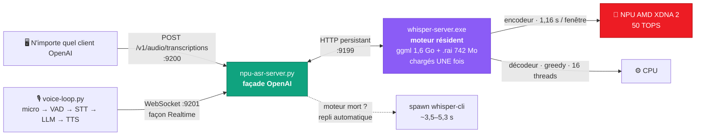

<div align="center">

# 🎙️ whisper-npu

### Transcription vocale privée et temps réel sur NPU AMD — sans cloud, sans GPU

Whisper `large-v3-turbo` avec l'encodeur qui tourne **entièrement sur le NPU Ryzen AI XDNA 2**
(50 TOPS), devant une **stack de service persistante compatible OpenAI** qui garde le modèle
résident et ne perd jamais une requête.

[](LICENSE)
[](#-mat%C3%A9riel--logiciels-test%C3%A9s)
[](#-les-r%C3%A8gles-du-npu-apprises-%C3%A0-nos-d%C3%A9pens)
[](#-performances-mesur%C3%A9es)
[](#%EF%B8%8F-lancer-les-serveurs-compatibles-openai)

**~1,1 s** par énoncé · **2,9 % de WER** en français · **×4,8** plus rapide que 16 threads CPU · **100 % local**

[⚡ Performances](#-performances-mesur%C3%A9es) · [🚀 Démarrage](#-d%C3%A9marrage-rapide) · [🧠 Règles NPU](#-les-r%C3%A8gles-du-npu-apprises-%C3%A0-nos-d%C3%A9pens) · [📚 Documentation](#-documentation) · [🇬🇧 English](README.md)

</div>

---

## La stack en un coup d'œil



Tout ce que montre ce diagramme est du code qui tourne, mesuré sur du vrai matériel — y compris les chemins de défaillance.

## Pourquoi ce dépôt existe

AMD publie un [fork](https://github.com/amd/whisper.cpp) de whisper.cpp qui déporte l'encodeur
Whisper sur leurs NPU via des caches `.rai` précompilés. La documentation s'arrête là.
Ce dépôt est tout ce qu'il a fallu comprendre pour en faire un outil de production :

- 🔨 **le compiler sous Windows** (MSVC, pas MSYS) avec le runtime `flexmlrt` — et où le trouver
  quand le portail AMD bloque les scripts
- 🧠 **les règles dures du NPU XDNA 2** — les enfreindre *corrompt silencieusement les sorties*
  (voir plus bas)
- ⚡ un patch de **pipelining inter-fichiers** (+35 % de débit) qui occupe le NPU pendant les décodes CPU
- 🛡️ une **stack de service persistante** : le moteur garde modèle + contexte NPU résidents
  (~1,1 s/énoncé), et la façade **retombe sur un spawn whisper-cli** si le moteur meurt —
  la transcription ne s'arrête jamais
- 🗣️ une **boucle vocale** (micro → VAD → STT → LLM → TTS) avec transcription spéculative et
  TTS streamé par phrase, exposée en WebSocket façon Realtime API
- 🔬 une tentative documentée de **recompilation du `.rai`** à fenêtre réduite — les raisons
  mesurées de l'échec (le padding 30 s appris par Whisper) et la piste restante

## ⚡ Performances mesurées

Matériel réel, audio réel, méthodologie complète dans [bench/RESULTS.md](bench/RESULTS.md) (EN)
et [docs/03-benchmarks.md](docs/03-benchmarks.md) (EN).

| Métrique | Valeur |
|---|---|
| Encodeur, NPU vs CPU 16 threads | **1160 ms vs 5540 ms** par fenêtre 30 s — **×4,8** |
| Pipeline complet de transcription (greedy) | **×12,5 temps réel** |
| WER sur notes vocales FR arbitrées à 3 sources | **2,9 % médian** (large-v3-turbo) |
| Petits modèles sur le français parlé | tiny 44 %, base 32 % de WER — *inutilisables* ; seul turbo est viable |
| API REST, énoncé 1,8 s (moteur lancé) | **1,11–1,16 s** |
| API REST, fichier dense de 40 s (2 fenêtres NPU) | **3,3–3,5 s** |
| API REST, moteur mort (repli spawn) | ~3,5–5,3 s — **fonctionne quand même** |
| Boucle vocale, fin de parole → texte | **1,46 s** (STT 1,31 s, déclenchement spéculatif) |
| Boucle vocale, texte → premier mot parlé | **0,41–0,50 s** (TTS par phrase) |

## 🧠 Les règles du NPU (apprises à nos dépens)

1. **Un seul pipeline NPU à la fois.** La stack flexmlrt/XRT n'a pas de file multi-contexts
   fiable. Lancer 3 workers concurrents produit des erreurs `ERT_CMD_STATE_TIMEOUT`
   *et — pire — des transcriptions corrompues en silence* (texte fluide mais faux).
   Un process, tout sérialisé.
2. **Décodage greedy (`-bs 1`) pour le batch.** Le beam search occupe le CPU pendant que le NPU
   dort ; greedy divise la phase CPU par ~3 sans perte mesurée.
3. **La fenêtre du `.rai` est fixée à 30 s.** `-ac` est ignoré par le cache précompilé : un énoncé
   de 2 s coûte le même encode 1,16 s qu'un de 30 s. Les fenêtres courtes exigent une
   recompilation ([docs/08-recompilation.md](docs/08-recompilation.md)) — et l'architecture
   de Whisper s'y oppose.
4. **Le VAD du fork segfaulte** (`whisper_vad`), même avec un modèle Silero valide. Ce dépôt le
   rend opt-in (`WHISPER_ALLOW_VAD=1`) ; faites le VAD dans votre orchestrateur.

## 🚀 Démarrage rapide

Prérequis : Windows 11, VS 2022 Build Tools (C++), CMake, Git, Python 3.12, ffmpeg.

```bat
:: 1. cloner le fork AMD et appliquer notre patch
git clone https://github.com/amd/whisper.cpp
cd whisper.cpp
git apply ..\whisper-npu\patches\0001-whisper-npu-full-patch.patch

:: 2. runtime flexmlrt (miroir si le portail AMD bloque :
::    github.com/lemonade-sdk/whisper.cpp-builds/releases/tag/deps)

:: 3. compiler (scripts adaptés dans scripts/build/)
build-npu.bat

:: 4. modèles : ggml-large-v3-turbo.bin (ggerganov/whisper.cpp)
::              ggml-large-v3-turbo-encoder-vitisai.rai (amd/whisper-large-turbo-onnx-npu)

:: 5. transcrire — vérifiez la bannière VitisAI qui confirme le déport NPU
whisper-cli -m models\ggml-large-v3-turbo.bin -f audio.wav -l fr -bs 1 -t 16
```

Guide complet avec tous les pièges : [docs/01-installation.md](docs/01-installation.md) (EN)

## 🖥️ Lancer les serveurs (compatibles OpenAI)

```bat
scripts\server\start-servers.bat     :: moteur :9199 + API :9200 + WS :9201 (idempotent)
scripts\server\stop-servers.bat      :: arrête les trois
```

```bash
# n'importe quel client OpenAI fonctionne tel quel
curl http://127.0.0.1:9200/v1/audio/transcriptions \
  -F file=@note.opus -F model=whisper-large-v3-turbo -F language=fr
# -> {"text": "..."} en ~1,1 s (énoncé 1,8 s, moteur lancé)
```

Détails : [docs/05-servers.md](docs/05-servers.md) (EN) · boucle vocale : [docs/06-voice-loop.md](docs/06-voice-loop.md) (EN)

## 📦 Contenu du dépôt

```
whisper-npu/
├── patches/                 modifications du fork : pipeline, fix VAD, pont ONNX
├── scripts/
│   ├── build/               scripts MSVC (base / pipeline / pont ORT / serveur)
│   ├── server/              stack de service : start/stop-servers.bat,
│   │                        npu-asr-server.py (façade OpenAI),
│   │                        voice-stream-server.py (WS temps réel),
│   │                        voice-loop.py (boucle micro) + modèles VAD/TTS locaux (hors git)
│   ├── tools/               benchmarks, comparaison de modèles, génération de rapports
│   └── dataset/             arbitrage 3 sources, recompilation .rai
├── docs/                    la connaissance (index dans le README EN)
├── bench/                   résultats mesurés
└── LICENSE                  MIT
```

## 📚 Documentation

Toute la documentation détaillée est rédigée en anglais : [index complet dans le README EN](README.md#-documentation).

| Doc | Contenu |
|---|---|
| [01-installation](docs/01-installation.md) | Installation Windows complète, tous les pièges |
| [02-usage](docs/02-usage.md) | CLI, transcription batch, choix du modèle |
| [03-benchmarks](docs/03-benchmarks.md) | Toutes les mesures : modèles, CPU vs NPU, pipeline, serveurs |
| [04-pipeline](docs/04-pipeline.md) | Le patch de pipelining : design, impasses, architecture finale |
| [05-servers](docs/05-servers.md) | API compatible OpenAI + endpoint WebSocket temps réel |
| [06-voice-loop](docs/06-voice-loop.md) | L'assistant vocal local : VAD, STT spéculatif, TTS streamé, barge-in |
| [07-npu-rules](docs/07-npu-rules.md) | Les règles XDNA 2 — l'enquête sur la corruption silencieuse |
| [08-recompilation](docs/08-recompilation.md) | Recompiler `.rai`/encodeurs custom : toolchain, résultats, blocages |
| [09-troubleshooting](docs/09-troubleshooting.md) | Chaque erreur rencontrée et son correctif |

## 🧪 Matériel & logiciels testés

- **AMD Ryzen AI Max+ 395** (« Strix Halo ») — NPU XDNA 2, 50 TOPS, driver 32.0.20102.3930
- Windows 11 Pro, VS 2022 Build Tools 14.44, CMake 3.29
- fork whisper.cpp (`amd/whisper.cpp` @ b40e6c8), flexmlrt 1.7.0
- Devrait fonctionner sur les Ryzen AI série 300 (même XDNA 2, mêmes fichiers `.rai`)

## 📄 Licence & crédits

MIT — voir [LICENSE](LICENSE). whisper.cpp est MIT ; le fork AMD et les modèles `.rai` suivent
leurs licences respectives.

Construit par essais, erreurs et mesures — une longue soirée sur du vrai matériel, par Arnaud
avec Claude Code. Le fork [`amd/whisper.cpp`](https://github.com/amd/whisper.cpp) et le miroir
[lemonade-sdk](https://github.com/lemonade-sdk) ont rendu cela possible.

<sub>Le NPU n'a pas de compteurs de perf — croyez la bannière VitisAI, pas le Gestionnaire des tâches.</sub>
