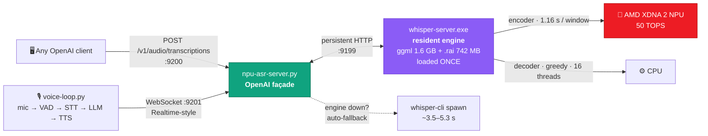

<div align="center">

# 🎙️ whisper-npu

### Private, real-time speech-to-text on an AMD NPU — no cloud, no GPU

Whisper `large-v3-turbo` with its encoder running **entirely on the Ryzen AI XDNA 2 NPU**
(50 TOPS), fronted by a **persistent OpenAI-compatible serving stack** that keeps the model
resident and never drops a request.

[](LICENSE)
[](#-hardware--software-tested)
[](#-the-npu-rules-learned-the-hard-way)
[](#-measured-performance)
[](#%EF%B8%8F-run-the-servers-openai-compatible)

**~1.1 s** per utterance · **2.9 % WER** on French · **4.8×** faster than 16-thread CPU · **100 % local**

[⚡ Benchmarks](#-measured-performance) · [🚀 Quick start](#-quick-start) · [🧠 NPU rules](#-the-npu-rules-learned-the-hard-way) · [📚 Documentation](#-documentation) · [🇫🇷 Français](README.fr.md)

</div>

---

## The stack at a glance



Everything in this diagram is running code, measured on real hardware — including the failure paths.

## Why this exists

AMD ships an [undocumented fork](https://github.com/amd/whisper.cpp) of whisper.cpp that offloads the
Whisper encoder to their NPUs via precompiled `.rai` caches. That's where the documentation stops.
This repo is everything needed to make it **production-grade**:

- 🔨 **Building it on Windows** (MSVC, not MSYS) with the `flexmlrt` runtime — and where to get it
  when AMD's portal blocks scripts
- 🧠 **The hard rules of the XDNA 2 NPU** — breaking them *silently corrupts output* (see below)
- ⚡ An **inter-file pipelining patch** (+35 % throughput) that keeps the NPU busy during CPU decoding
- 🛡️ A **persistent serving stack**: the engine keeps model + NPU context resident (~1.1 s/utterance),
  and the façade **falls back to a whisper-cli spawn** if the engine dies — transcription never stops
- 🗣️ A **voice loop** (mic → VAD → STT → LLM → TTS) with speculative transcription and
  sentence-streamed TTS, exposed over a Realtime-style WebSocket
- 🔬 A documented attempt at **recompiling the `.rai`** with a shorter window — the measured reasons
  it fails (Whisper's learned 30 s padding) and the remaining path

## ⚡ Measured performance

Real hardware, real audio, full methodology in [bench/RESULTS.md](bench/RESULTS.md) and
[docs/03-benchmarks.md](docs/03-benchmarks.md).

| Metric | Value |
|---|---|
| Encoder, NPU vs 16-thread CPU | **1160 ms vs 5540 ms** per 30 s window — **4.8×** |
| Full transcription pipeline (greedy) | **×12.5 real-time** |
| WER, 3-source-arbitrated French voice notes | **2.9 % median** (large-v3-turbo) |
| Smaller models on conversational French | tiny 44 %, base 32 % WER — *unusable*; only turbo is viable |
| REST API, 1.8 s utterance (engine up) | **1.11–1.16 s** |
| REST API, 40 s dense file (2 NPU windows) | **3.3–3.5 s** |
| REST API, engine down (spawn fallback) | ~3.5–5.3 s — **still works** |
| Voice loop, end of speech → text | **1.46 s** (STT 1.31 s, speculative trigger) |
| Voice loop, text → first spoken word | **0.41–0.50 s** (sentence-streamed TTS) |

## 🧠 The NPU rules (learned the hard way)

1. **One NPU pipeline at a time.** The flexmlrt/XRT stack has no reliable multi-context queue.
   Running 3 concurrent workers produces `ERT_CMD_STATE_TIMEOUT` errors *and — worse — silently
   corrupted transcripts* (stale encoder buffers read as plausible-but-wrong text). One process,
   serialize everything.
2. **Greedy decoding (`-bs 1`) for batch work.** Beam search spends CPU time while the NPU sits
   idle; greedy cuts the CPU phase ~3× with negligible accuracy loss on clean speech.
3. **The `.rai` window is fixed at 30 s.** `-ac` (audio context) is ignored by the precompiled
   cache: a 2 s utterance and a 30 s one cost the same 1.16 s encode. Short windows require
   recompilation ([docs/08-recompilation.md](docs/08-recompilation.md)) — and Whisper's
   architecture fights you there.
4. **The stock fork's VAD segfaults** (`whisper_vad`), even with a valid Silero model loaded.
   This repo's patch makes VAD opt-in via `WHISPER_ALLOW_VAD=1`; do VAD in your orchestrator.

## 🚀 Quick start

Prerequisites: Windows 11, VS 2022 Build Tools (C++), CMake, Git, Python 3.12, ffmpeg.

```bat
:: 1. clone the AMD fork and apply our patch
git clone https://github.com/amd/whisper.cpp
cd whisper.cpp
git apply ..\whisper-npu\patches\0001-whisper-npu-full-patch.patch

:: 2. get the flexmlrt runtime (AMD's portal may block scripts —
::    mirror: github.com/lemonade-sdk/whisper.cpp-builds/releases/tag/deps)
::    extract, then point the build at it (see scripts/build/build-npu.bat)

:: 3. build (scripts adapted from scripts/build/)
build-npu.bat

:: 4. download the models
::    HF: ggml-large-v3-turbo.bin      (ggerganov/whisper.cpp)
::        ggml-large-v3-turbo-encoder-vitisai.rai (amd/whisper-large-turbo-onnx-npu)

:: 5. transcribe — verify the VitisAI banner confirms NPU offload
whisper-cli -m models\ggml-large-v3-turbo.bin -f audio.wav -l fr -bs 1 -t 16
```

Full walkthrough with every trap: [docs/01-installation.md](docs/01-installation.md)

## 🖥️ Run the servers (OpenAI-compatible)

```bat
scripts\server\start-servers.bat     :: engine :9199 + API :9200 + WS :9201 (idempotent)
scripts\server\stop-servers.bat      :: stops all three
```

```bash
# any OpenAI client works as-is
curl http://127.0.0.1:9200/v1/audio/transcriptions \
  -F file=@note.opus -F model=whisper-large-v3-turbo -F language=fr
# -> {"text": "..."} in ~1.1 s (1.8 s utterance, engine up)
```

Details: [docs/05-servers.md](docs/05-servers.md) · voice loop: [docs/06-voice-loop.md](docs/06-voice-loop.md)

## 📦 What's inside

```
whisper-npu/
├── patches/                 fork modifications: pipelining, VAD fix, ORT bridge
├── scripts/
│   ├── build/               MSVC build scripts (base / pipeline / ORT / server)
│   ├── server/              serving stack: start/stop-servers.bat,
│   │                        npu-asr-server.py (OpenAI façade),
│   │                        voice-stream-server.py (WS realtime),
│   │                        voice-loop.py (mic loop) + local VAD/TTS models (gitignored)
│   ├── tools/               benchmarks, model comparison, report generation
│   └── dataset/             3-source transcription arbitration, .rai recompilation
├── docs/                    the knowledge (index below)
├── bench/                   measured results
└── LICENSE                  MIT
```

## 📚 Documentation

| Doc | Contents |
|---|---|
| [01-installation](docs/01-installation.md) | Full Windows setup, every pitfall (portal blocks, MSYS vs MSVC, DLL placement) |
| [02-usage](docs/02-usage.md) | CLI usage, batch transcription, model choice |
| [03-benchmarks](docs/03-benchmarks.md) | All measurements: models, CPU vs NPU, pipeline, servers |
| [04-pipeline](docs/04-pipeline.md) | The inter-file pipelining patch: design, dead-ends, final architecture |
| [05-servers](docs/05-servers.md) | OpenAI-compatible API + WebSocket realtime endpoint |
| [06-voice-loop](docs/06-voice-loop.md) | The local voice assistant: VAD, speculative STT, TTS streaming, barge-in |
| [07-npu-rules](docs/07-npu-rules.md) | XDNA 2 behavior rules — the silent-corruption deep dive |
| [08-recompilation](docs/08-recompilation.md) | Rebuilding `.rai`/custom encoders: toolchain, results, blockers |
| [09-troubleshooting](docs/09-troubleshooting.md) | Every error we hit and its fix |

## 🧪 Hardware & software tested

- **AMD Ryzen AI Max+ 395** ("Strix Halo") — NPU XDNA 2, 50 TOPS, driver 32.0.20102.3930
- Windows 11 Pro, VS 2022 Build Tools 14.44, CMake 3.29
- whisper.cpp fork (`amd/whisper.cpp` @ b40e6c8), flexmlrt 1.7.0
- Should translate to Ryzen AI 300-series (same XDNA 2, same `.rai` files)

## 📄 License & credits

MIT — see [LICENSE](LICENSE). The underlying whisper.cpp is MIT; AMD's fork and `.rai` models
follow their respective licenses.

Built by trial, error, and measurement — one long evening on real hardware, by Arnaud with
Claude Code. The [`amd/whisper.cpp`](https://github.com/amd/whisper.cpp) fork and the
[lemonade-sdk](https://github.com/lemonade-sdk) mirror made this possible.

<sub>NPU has no perf counters — trust the VitisAI banner, not Task Manager.</sub>
